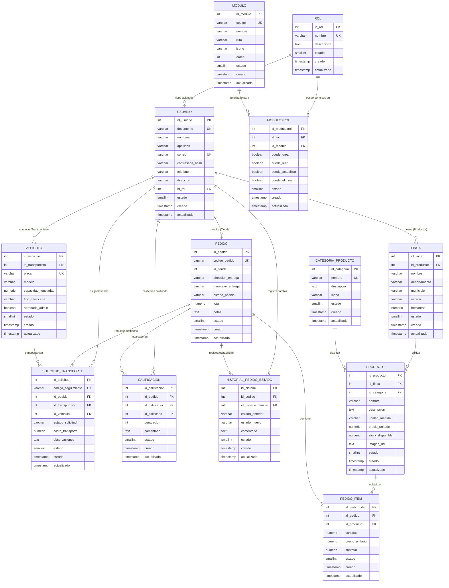
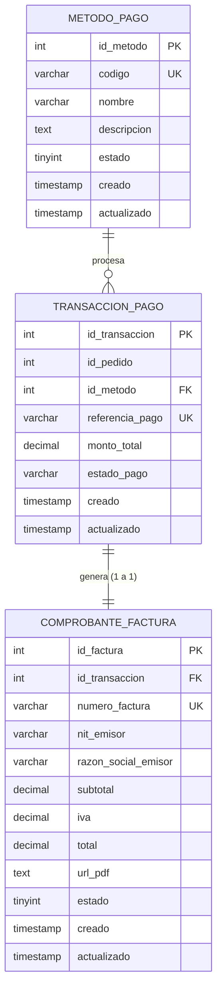

# Diagrama Relacional de Base de Datos — AgroConecta (FreshLink)

**Proyecto:** AgroConecta (FreshLink)  
**Asignatura:** Desarrollo Web / Taller 1 & Parcial 1 Corte 2  
**Docente:** Mg. Bryan Fernandez Ebrath  
**Comisión:** 11  

---

## 1. Diagrama Entidad-Relación (PostgreSQL Neon - 13 Tablas Normalizadas)

---

## 2. Diagrama Entidad-Relación (MySQL Aiven - 3 Tablas Auxiliares)

---

## 3. Matriz de Auditoría y Borrado Lógico

Todas las tablas en ambos motores de base de datos implementan rigurosamente:

* **`estado`:** Control de borrado lógico (`1` = Activo / Visible en frontend, `0` = Inactivo / Dado de baja lógica). Los registros nunca se destruyen físicamente (`DELETE FROM` prohibido).
* **`creado`:** Marca de tiempo generada automáticamente en el `INSERT`.
* **`actualizado`:** Marca de tiempo actualizada automáticamente en cada `UPDATE` vía triggers de base de datos (`actualizar_timestamp_trigger()`).

