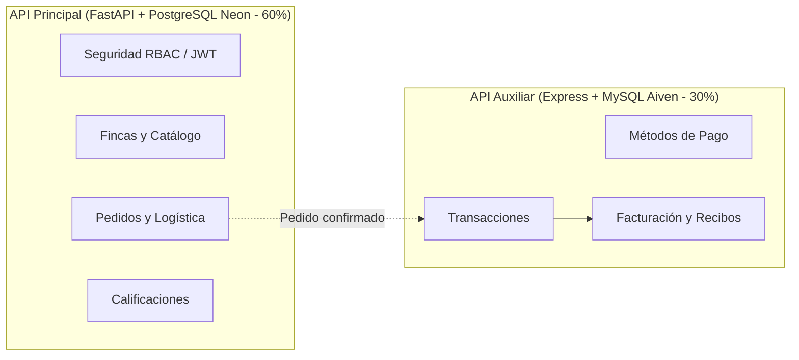

# Resumen de Propuesta: AgroConecta (FreshLink)

> **Evaluación:** Parcial I (10 %) | **Comisión:** 11  
> **Plataforma:** AgroConecta — Conexión Directa del Campo a la Ciudad  

---

## 1. Problemática

En la comercialización agropecuaria tradicional, los pequeños campesinos enfrentan tres barreras críticas:
1. **Intermediación excesiva:** Los intermediarios capturan la mayor ganancia, dejando al productor rural con ingresos mínimos que apenas cubren costos.
2. **Desconexión con comercios urbanos:** Tiendas y restaurantes carecen de canales directos y transparentes para comprar cosechas frescas de origen garantizado.
3. **Brecha logística y transporte informal:** No hay un sistema formal para coordinar fletes rurales, lo que genera retrasos y pérdidas de alimentos perecederos.

---

## 2. Población Objetivo

| Actor | Perfil | Rol en la Plataforma |
| :--- | :--- | :--- |
| **Productores Campesinos** | Pequeños y medianos agricultores con fincas. | Registran fincas, publican cosechas con precio/stock y despachan pedidos. |
| **Tiendas y Comercios** | Fruterías, restaurantes y minimercados urbanos. | Compran cosechas frescas por catálogo, siguen envíos y califican el servicio. |
| **Transportistas** | Conductores de vehículos de carga rural/urbana. | Registran vehículos, aceptan fletes, trasladan la carga y entregan en destino. |
| **Administradores** | Equipo de gestión y supervisión. | Controlan usuarios, aprueban vehículos, auditan roles y gestionan reclamos. |

---

## 3. Requerimientos Generales del Sistema

1. **Seguridad y Control de Acceso (RBAC + JWT):**
   * Autenticación con tokens JWT cifrados con `bcrypt`.
   * Permisos por módulo y rol mediante las entidades obligatorias `rol`, `usuario`, `modulo` y `moduloxrol`.
2. **Borrado Lógico y Auditoría Transversal:**
   * Todas las tablas incorporan `estado` (1 activo / 0 inactivo sin eliminación física), `creado` y `actualizado` automáticos.
3. **Catálogo y Fincas:**
   * Registro de unidades productivas georreferenciadas y publicación de cosechas con control de stock.
4. **Ciclo de Pedidos y Logística:**
   * Carrito de compra, cálculo de totales, asignación de transportistas aprobados y trazabilidad histórica de estados (`PENDIENTE` → `ENTREGADO`).
5. **Subsistema de Pagos y Calidad:**
   * Registro de pagos y facturación, junto con valoraciones (1 a 5 estrellas) para construir reputación confiable.

---

## 4. Arquitectura de Dos APIs

* **FastAPI + PostgreSQL (13 tablas):** Gestiona el núcleo del negocio agrícola, seguridad y flujo operativo.
* **Express + MySQL (3 tablas):** Microservicio auxiliar desacoplado para pagos, transacciones y facturación.
